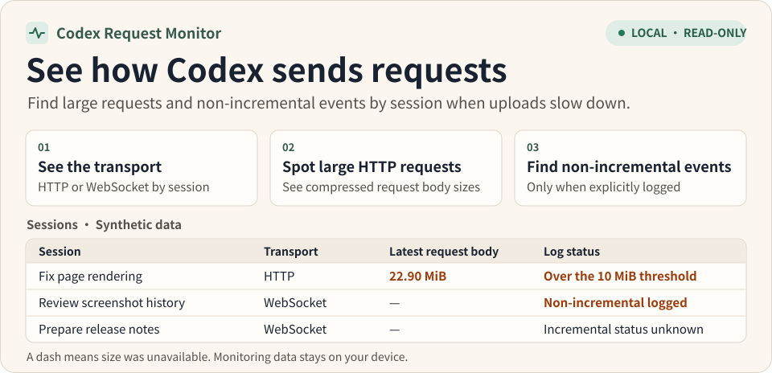

<p align="center">
  
</p>

<h1 align="center">Codex Session Connection Monitor</h1>

<p align="center">
  <strong>See how each Codex session connects, identify chats that repeatedly upload full context, and get guidance to reduce bandwidth use and waiting time.</strong>
</p>

<p align="center">
  <a href="LICENSE"></a>
  
  
  
</p>

<p align="center">
  <a href="#how-it-works">How it works</a> · <a href="#install-and-use">Install</a> · <a href="#read-the-dashboard">Dashboard guide</a> · <a href="PRIVACY.md">Privacy</a> · <a href="#run-the-tests">Development</a>
</p>

<p align="center">
  <a href="README.md">简体中文</a> | <strong>English</strong>
</p>

---

Codex Session Connection Monitor shows transport, request body sizes, and recorded HTTP upload totals for each chat. Alerts for large requests and explicitly logged non-incremental WebSocket events help you locate slow uploads and excessive bandwidth use. All monitoring data is processed locally.

- **More bandwidth** — After HTTP fallback, each model request resends the full context. More screenshots in the history mean more data uploaded repeatedly.
- **Longer waits** — One task can call the model many times. Uploading the history before each call adds to the wait.

**Comparison scenario (estimated)**: One coding task triggers 25 model requests over a 10 Mbps upstream connection. HTTP uses a local measured sample's average of about 15.77 MiB per request; incremental assumes 100 KiB per request. The table compares upload time only, not total task time.

| Metric | ⚠️ Full-context HTTP (based on a measured sample) | ✅ Incremental (hypothetical) |
|---|---:|---:|
| Total request body size | **About 394 MiB** | **About 2.44 MiB** |
| Upload time (estimated) | **About 5 min 31 sec** | **About 2 sec** |

## Install and use

The macOS beta requires Python 3.9 or later. `v0.2.1-beta` includes direct chat navigation from session titles, the bilingual dashboard, latest requested model, and evidence-based incremental state. The dashboard opens in Chinese for Chinese locales and in English otherwise. Use the language selector to switch at any time. Session titles stay in their original language.

### 1. Terminal installation (recommended)

Requires Codex desktop and a Codex CLI with the `plugin` command.

```sh
codex plugin marketplace add wolf3c/codex-request-monitor --ref v0.2.1-beta
codex plugin add codex-request-monitor@codex-request-monitor-marketplace
```

### 2. Ask Codex to install it

Copy the following prompt into a local Codex conversation and send it.

```text
Please install the Codex Request Monitor plugin on this computer.

First check that Python 3.9+ and the codex plugin command are available, then run:

codex plugin marketplace add wolf3c/codex-request-monitor --ref v0.2.1-beta
codex plugin add codex-request-monitor@codex-request-monitor-marketplace

After installation, verify that the plugin is installed and explain how to open it from the left sidebar's ⋯ menu.
If additional permissions are needed, explain why. Ask for my consent before restarting Codex.
```

### 3. Install from the desktop app

1. Open **Plugins → Add plugin marketplace**.
2. Set **Source** to `wolf3c/codex-request-monitor` and **Git ref** to `v0.2.1-beta`.
3. Click **Add marketplace**, find the monitor, and click **Install**. The plugin is listed as **Codex Request Monitor**.

### Open the installed dashboard

Open the monitor from the **⋯** menu in the desktop sidebar. Use the pin to keep it there. If the entry is missing, reopen the desktop app after your running tasks finish.

### Run in a browser

Run this command from the repository root. If a browser tab does not open, use the local address printed in the terminal.

```sh
python3 plugins/codex-request-monitor/monitor.py
```

## Read the dashboard

- The proxy status below the launch button expands into diagnostic details. Opening or returning to the page, and every 15 seconds while visible, automatically inspects launch proxy variables in Codex-related macOS processes, candidate proxy variable names in the configuration directory’s `.env` file, system proxy configuration, TUN interfaces, and configured loopback proxy ports. It does not change settings, run proxy launch scripts, or access external services. Configuration, TCP reachability, and TUN interfaces do not prove actual request routing; insufficient evidence is shown as “Unconfirmed”.
- The overview shows large HTTP requests and active non-incremental WebSocket alerts from the last five minutes. Expand the 24-hour summary for historical counts.
- Expand a session to see up to ten recorded events and the 24-hour sum of logged compressed HTTP request bodies. This sum reflects prepared request bodies. A failed request may have sent fewer bytes.
- Incremental state shows “Incremental” or “Non-incremental” only with explicit evidence for the latest request; insufficient evidence appears as `-`. Missing WebSocket or download sizes also appear as `-`.
- “Latest requested model” shows only the latest request’s logged model ID, or `-` when missing. It does not prove which model the server actually executed.
- Click a session title to open its Codex chat directly; an underline and external-link icon appear on hover. Use the arrow on the left to expand or collapse details. HTTP session details also include a manual WebSocket retry guide. Archiving may interrupt the session and its subtasks.

Observed-route checks match Codex TCP sockets with connection records, outbound adapter types, and bidirectional transfer counters from an existing local Clash/Mihomo Unix API. Confirmed proxy traffic shows “Proxy is active. No action needed.”; confirmed DIRECT traffic shows “Proxy is inactive. Temporary proxy recommended.” Mixed routes, no active connections, missing permissions, and unsupported proxy apps show “Pending confirmation”. This covers sampled Codex service connections, not every chat or incremental transmission.

### Temporary proxy launch (current source)

Network diagnostics and temporary proxy launch are not included in the pinned `v0.2.1-beta` release above.

The page automatically checks conditions and shows “Launch Codex with temporary proxy”. The button is disabled when Codex is running or conditions are unconfirmed, with a short reason below. The sidebar entry opens the standalone page in your external browser so it remains usable after you quit Codex.

- **This launch only:** detects a local HTTP/mixed proxy from system settings and starts Codex with child-process environment variables. It does not modify `.env`, shell configuration, or the system proxy. After fully quitting this instance, a normal launch uses your original configuration.
- **Protects existing tasks:** idleness of every chat and subtask cannot currently be established reliably. Automatic restart is blocked whenever the app or its background processes are running. Finish tasks and quit the app yourself first. Missing process evidence also blocks launch.
- **Preserves user configuration:** an existing `.env` conservatively blocks launch because its overrides cannot yet be ruled out precisely. The tool does not ask you to delete or rewrite it. Ambiguous apps, missing local proxies, and `NO_PROXY` exclusions covering the Codex service also block launch.
- **Revalidates before launch:** checks an HTTP CONNECT tunnel to `chatgpt.com:443`, then checks the app and proxy configuration again. Only the fixed connection target is sent, without account credentials or chat content. This does not prove WebSocket availability.

“Launch requested” only means the launch command was submitted. Use subsequent real session logs to verify WebSocket and incremental transfer. If the outcome is unconfirmed, check the app state before trying again.

## Privacy and compatibility

The monitor reads local Codex SQLite diagnostics and sends no monitoring data to an external service. See the [privacy policy](PRIVACY.md). Log availability depends on the Codex version. Include the OS, Codex version, and a redacted description when filing an issue.

## Run the tests

```sh
cd plugins/codex-request-monitor
python3 -B -m unittest
node --test test_sidebar_ui.cjs
```

## How it works

**Why can archiving and reopening trigger a retry?** In the tested Codex version, archiving unloads the chat runtime, clearing its retained HTTP fallback state. Unarchiving and reopening the original chat lets the next request try a new WebSocket connection while preserving the chat ID and history. The plugin only provides manual guidance. Archiving may interrupt the chat and its subtasks; you must continue them yourself afterward.

**Why is success not guaranteed?** Resetting the runtime does not fix the underlying WebSocket failure. Network or server issues, or large historical context, can cause another HTTP fallback. The first request on a new connection may also resend history, so WebSocket does not necessarily mean incremental transfer. The dashboard marks incremental transfer only with explicit log evidence; otherwise it shows `-`.

## License

This project is licensed under the [MIT License](LICENSE). Copyright (c) 2026 wolf3c.
