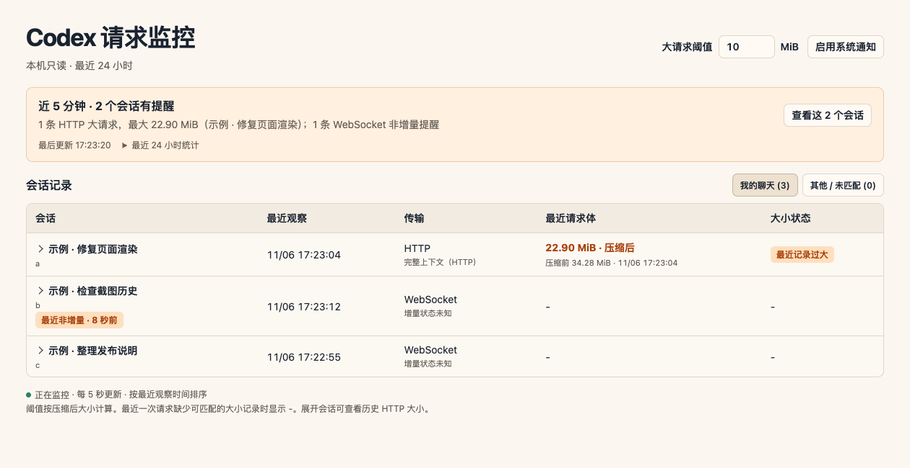

# Codex Request Monitor

Codex 请求监控是一个本机只读诊断面板。Codex 卡住或网络上传异常时，可以按会话查看日志记录的 HTTP / WebSocket 传输方式、HTTP 请求体大小和明确记录的 WebSocket 非增量事件。

This local, read-only diagnostic dashboard shows which Codex conversation used HTTP or WebSocket, the HTTP request body sizes recorded by Codex, and explicitly logged non-incremental WebSocket events. It does not intercept traffic or change how Codex sends requests.



截图使用合成数据。 Screenshot uses synthetic data.

## 安装 / Install

首发为 macOS 测试版。需要本机 Codex 桌面版、可用的 Python 3.9+，以及支持 `codex plugin` 命令的 Codex CLI。本项目此前在内置 `codex-cli 0.166.0-alpha.6` 的桌面环境开发，其他版本及操作系统需要单独验证。

在终端运行 / In a terminal:

```sh
codex plugin marketplace add wolf3c/codex-request-monitor --ref v0.1.0-beta
codex plugin add codex-request-monitor@codex-request-monitor-marketplace
```

打开 Codex 桌面版，在最左侧「⋯」里找到「Codex 请求监控」，可用图钉固定。首次安装后如果没有出现入口，等当前任务结束后重新打开桌面应用。也可以克隆本仓库，从本机目录运行同一个面板：

```sh
python3 plugins/codex-request-monitor/monitor.py
```

In the desktop app, find **Codex 请求监控** under the left sidebar’s **⋯** menu and pin it if desired. The Python command above is a standalone localhost alternative.

## 怎么读面板

- 顶部显示近 5 分钟的 HTTP 大请求和有效的 WebSocket 非增量提醒。点「查看这几个会话」可筛出相应记录；24 小时统计可单独展开。
- 主表只显示能归到最近一次请求的大小。展开会话可查看近期已记录事件和最近 24 小时的 HTTP 压缩请求体合计。
- 压缩后大小来自本机 HTTP 日志，代表准备好的请求体大小。请求可能失败，数字不等同于成功上传的流量、VPN 账单或 Token 用量。
- WebSocket 通常没有可归属到会话的字节数。仅观察到 WebSocket 时，增量状态保持未知。下载字节数缺少可靠记录，显示 `-`。
- HTTP 会话可打开手动重试指南。归档由用户在 Codex 中操作，可能中断会话和子任务。新请求的传输结果只有在日志证据足够时才会显示。

## 本机数据与兼容性

插件以只读方式查询本机 Codex SQLite 日志与会话索引，在面板中显示必要的会话标题、标识及请求统计。它没有第三方遥测，也不会上传会话记录、请求正文或凭据。桌面版通过本机 stdio MCP 传输；独立浏览器版只监听回环地址。详见 [隐私说明](PRIVACY.md)。

日志格式和保留时间由 Codex 决定。遇到读取失败或数据缺失时，提交 Issue 请附操作系统、Codex 版本和脱敏后的现象描述。请勿附完整日志、凭据、请求正文或真实会话截图。

## 开发验证

```sh
cd plugins/codex-request-monitor
python3 -B -m unittest
```
