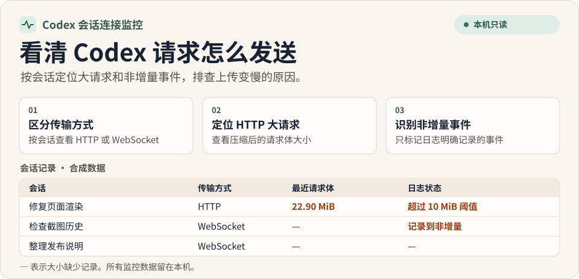

<p align="center">
  
</p>

<h1 align="center">Codex 会话连接监控</h1>

<p align="center">
  <strong>了解每个 Codex 会话的连接方式，定位反复上传完整上下文的对话，并提供优化建议，帮助减少流量消耗、缩短等待时间。</strong>
</p>

<p align="center">
  <a href="LICENSE"></a>
  
  
  
</p>

<p align="center">
  <a href="#工作原理">工作原理</a> · <a href="#安装与使用">安装</a> · <a href="#怎么读面板">面板说明</a> · <a href="PRIVACY.md">隐私说明</a> · <a href="#开发验证">开发验证</a>
</p>

<p align="center">
  <strong>简体中文</strong> | <a href="README.en.md">English</a>
</p>

---

Codex 会话连接监控按对话展示传输方式、请求体大小和已记录的 HTTP 上传合计，提醒你关注大请求与日志明确记录的 WebSocket 非增量事件，帮助定位上传变慢、流量异常的来源。所有监控数据仅在本机处理。

- **耗流量**：回退 HTTP 后，每次模型请求都会重传完整上下文，历史截图越多，重复上传的流量越大。
- **等得久**：一次任务可能多次调用模型，每次都要先上传历史内容，反复传输会累积等待时间。

**对比场景（估算）**：一次编程任务触发 25 次模型请求，上行带宽为 10 Mbps。HTTP 参考本机实测样本平均约 15.77 MiB/次，增量假设为 100 KiB/次；下表仅比较上传耗时，不代表任务总耗时。

| 对比项 | ⚠️ HTTP 全量传输（参考实测样本） | ✅ 增量传输（假设） |
|---|---:|---:|
| 累计请求体大小 | **约 394 MiB** | **约 2.44 MiB** |
| 上传耗时（估算） | **约 5 分 31 秒** | **约 2 秒** |

## 安装与使用

macOS 测试版，需要 Python 3.9+。插件在内置 `codex-cli 0.166.0-alpha.6` 的桌面版上开发。`v0.2.1-beta` 包含会话标题直接跳转、中英文面板、最近请求模型及基于日志证据的增量状态。面板默认跟随浏览器语言，可在右上角切换简体中文和英文。

### 1. 终端安装（推荐）

需要 Codex 桌面版和支持 `codex plugin` 的 CLI。

```sh
codex plugin marketplace add wolf3c/codex-request-monitor --ref v0.2.1-beta
codex plugin add codex-request-monitor@codex-request-monitor-marketplace
```

### 2. 让 Codex 帮你安装

把下面的提示词复制到本机 Codex 对话中发送。

```text
请在本机安装 Codex 请求监控插件。

先检查 Python 3.9+ 和 codex plugin 命令是否可用，再执行：

codex plugin marketplace add wolf3c/codex-request-monitor --ref v0.2.1-beta
codex plugin add codex-request-monitor@codex-request-monitor-marketplace

安装后验证插件是否已安装，并告诉我如何从左侧「⋯」打开。
如果需要权限，请说明具体原因。如果需要重启 Codex，请先征求我的同意。
```

### 3. 桌面安装（无需终端）

1. 打开 **Plugins → Add plugin marketplace**。
2. **Source** 填 `wolf3c/codex-request-monitor`，**Git ref** 填 `v0.2.1-beta`。
3. 点击 **Add marketplace**，找到 **Codex Request Monitor**，点击 **Install**。

### 打开已安装的面板

在 Codex 桌面版左侧 **⋯** 菜单打开监控面板，可用图钉固定。若入口未出现，等当前任务结束后重新打开桌面应用。

### 独立运行（无需安装插件）

在本仓库根目录运行以下命令，用浏览器打开终端显示的本机地址。

```sh
python3 plugins/codex-request-monitor/monitor.py
```

## 怎么读面板

- 「系统通知：开 / 关」独立控制系统弹窗，并在当前浏览器的同一监控地址记住选择，并同步到同地址的其他页面。关闭不会影响页面内提醒；开启时如尚未授权，会请求浏览器通知权限。

- 启动按钮下方显示代理状态，点击状态可展开诊断详情；页面打开、切回或保持可见时每 15 秒自动读取 macOS 上 Codex 相关进程的启动代理变量、配置目录 `.env` 中的候选代理变量名、系统代理和 TUN 接口，并检查已配置的本地代理端口。不会修改设置、运行代理启动脚本或访问外网；代理配置、TCP 可连接和 TUN 接口都不证明实际请求经过代理，证据不足显示「未确认」。
- 「会话记录」旁显示近 5 分钟有 HTTP 大请求或有效 WebSocket 非增量提醒的会话数，点击即可筛选；再次点击恢复列表。24 小时统计在表格下方展开。
- 主表只显示能归到最近一次请求的大小。展开会话可查看近期已记录事件和最近 24 小时的 HTTP 压缩请求体合计。
- 压缩后大小来自本机 HTTP 日志，代表准备好的请求体大小。请求可能失败，数字不等同于成功上传的流量、VPN 账单或 Token 用量。
- 增量状态按最近一次请求的明确日志证据显示为「增量」或「非增量」，证据不足显示 `-`。WebSocket 大小和下载字节数缺少可靠记录时也显示 `-`。
- 「最近请求模型」只显示最近一次请求日志中的模型 ID；没有记录时显示 `-`。它不能证明服务端实际执行了哪个模型。
- 点击会话标题直接打开对应 Codex 会话，悬停时显示链接下划线和外链图标；左侧箭头用于展开或收起明细。HTTP 会话明细中还可打开手动重试指南。归档由用户在 Codex 中操作，可能中断会话和子任务。新请求的传输结果只有在日志证据足够时才会显示。

实际连接判定会只读核对 Codex 进程的 TCP 连接与 Clash/Mihomo 本地 Unix 控制接口中的连接、出站类型和双向传输记录。确认经过代理显示「代理已生效，无需操作。」；确认 DIRECT 显示「代理未生效，建议开启临时代理。」；混合路由、无活动连接、权限不足或不支持的代理软件显示「待确认」。结果仅代表采样到的 Codex 服务连接，不代表每个对话或增量传输状态。

### 临时代理启动（当前源码）

网络诊断和临时代理启动尚未包含在上方固定的 `v0.2.1-beta` 发布包中。

页面会自动检查并显示「使用临时代理启动 Codex」按钮；已运行或条件未确认时置灰，并在下方显示原因。侧栏入口会打开独立的外部浏览器网页，方便退出 Codex 后继续操作。

- **仅本次启动生效**：自动识别系统配置中的本地 HTTP/mixed 代理，通过子进程环境变量启动 Codex，不修改 `.env`、Shell 配置或系统代理。完全退出本次实例后，再正常启动即沿用原有配置。
- **保护现有任务**：当前无法可靠确认所有对话和子任务空闲，因此只要应用或其后台进程仍在运行，就禁止自动重启。请先自行完成任务并退出应用；进程状态读取失败时同样禁止启动。
- **不覆盖用户配置**：当前对已有 `.env` 保守禁用，因为尚不能准确排除覆盖行为；不会要求删除或改写文件。无法确认唯一应用、本地代理或检测到 `NO_PROXY` 排除 Codex 服务时也会阻止启动。
- **启动前重新验证**：检查到 `chatgpt.com:443` 的 HTTP CONNECT 隧道，并再次检查应用与代理配置。只传送固定连接目标，不发送账号凭据或对话内容；此检查不证明 WebSocket 可用。

「已发起启动」仅说明启动命令已提交。后续请求是否使用 WebSocket、是否增量传输，仍以会话监控中的真实日志证据为准。启动结果未确认时请先检查应用状态，不要连续重试。

## 本机数据与兼容性

插件以只读方式查询本机 Codex SQLite 日志与会话索引，在面板中显示必要的会话标题、标识及请求统计。它没有第三方遥测，也不会上传会话记录、请求正文或凭据。桌面版通过本机 stdio MCP 传输；独立浏览器版只监听回环地址。详见 [隐私说明](PRIVACY.md)。

日志格式和保留时间由 Codex 决定。遇到读取失败或数据缺失时，提交 Issue 请附操作系统、Codex 版本和脱敏后的现象描述。请勿附完整日志、凭据、请求正文或真实会话截图。

## 开发验证

```sh
cd plugins/codex-request-monitor
python3 -B -m unittest
node --test test_sidebar_ui.cjs
```

## 工作原理

**为什么归档、恢复后能重试？** 在已验证的 Codex 版本中，归档会卸载对话运行态，清除其中保留的 HTTP 回退状态。取消归档并重新打开原对话后，下一次请求便有机会重新建立 WebSocket 连接；对话 ID 和历史保留。插件只提供手动引导，不会替你操作。归档可能中断对话及子任务，恢复后需自行继续。

**为什么不保证成功？** 重置运行态没有解决导致 WebSocket 失败的根因，网络、服务端或大体积历史上下文仍可能使请求再次回退 HTTP。新连接首次请求也可能重传历史，因此 WebSocket 不等于增量；面板有明确日志证据才标记增量，否则显示 `-`。

## 开源协议

本项目采用 [MIT License](LICENSE)。Copyright (c) 2026 wolf3c。
